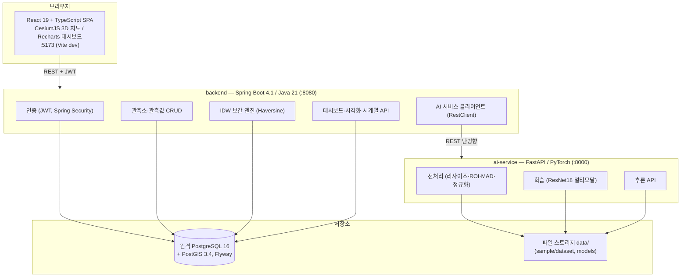
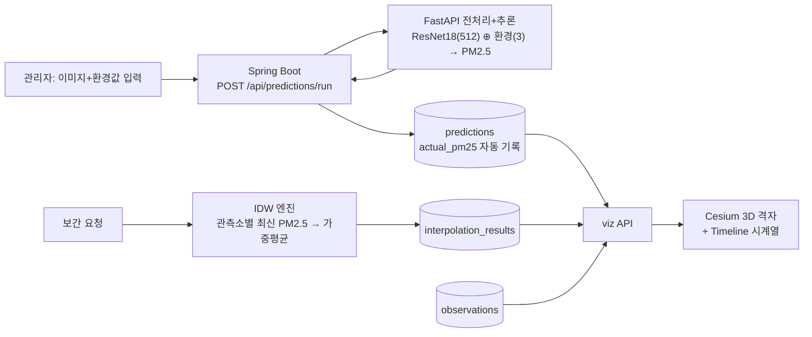

# 시스템 아키텍처

## 구성도

## 설계 결정과 근거

| 결정 | 근거 |
|---|---|
| Spring → FastAPI **단방향 호출** | 결합도 최소화. AI 서비스가 죽어도 CRUD·보간·시각화는 동작 (502로 명확히 안내) |
| 원격 PostgreSQL 직접 연결 (Docker 미사용) | 사용자 결정(2026-07-17). 접속 정보는 루트 .env, 스키마는 Flyway 자동 적용 |
| geom 컬럼 DB GENERATED | 앱은 위도/경도만 저장, PostGIS 좌표는 DB가 자동 생성 → 좌표 불일치 원천 차단 |
| 이미지·모델 파일은 파일시스템 | DB에는 경로만 저장. 대용량 파일 git 미포함 |
| 등급 기준 설정 파일 3곳 동기화 | 하드코딩 금지 원칙. 단일 기준은 api-spec.md에 명시 |
| JWT stateless 인증 | 세션 저장소 불필요, 역할 2개(USER/ADMIN)로 단순화 |
| Cesium ion 토큰 선택제 | 토큰 없으면 OSM 타일 폴백 → 외부 계정 없이 실행 가능 원칙 준수 |

## 데이터 흐름 (핵심 시나리오)

## 기술 스택 버전

frontend: React 19 / TS 6 / Vite 8 / Tailwind 4 / Zustand 5 / CesiumJS / Recharts ·
backend: Spring Boot 4.1 / Java 21 / Gradle 9 / Flyway / springdoc 3 ·
ai: Python 3.11 / FastAPI 0.115 / PyTorch 2.13(CPU) / pandas 3 / Pillow 12

## Boot 4 마이그레이션 참고 (트러블슈팅 이력)

- Flyway는 `spring-boot-starter-flyway` 필요 (flyway-core 단독으로는 실행 안 됨)
- `@WebMvcTest` 패키지: `org.springframework.boot.webmvc.test.autoconfigure`
- @WebMvcTest 슬라이스가 Filter 컴포넌트를 포함 → 보안 필터는 @Component 금지
- RestClient 기본 JDK HttpClient는 chunked+h2c 전송 → uvicorn multipart 실패,
  `SimpleClientHttpRequestFactory`(Content-Length 버퍼)로 해결
- MultipartBodyBuilder는 reactive-streams 의존성 필요
