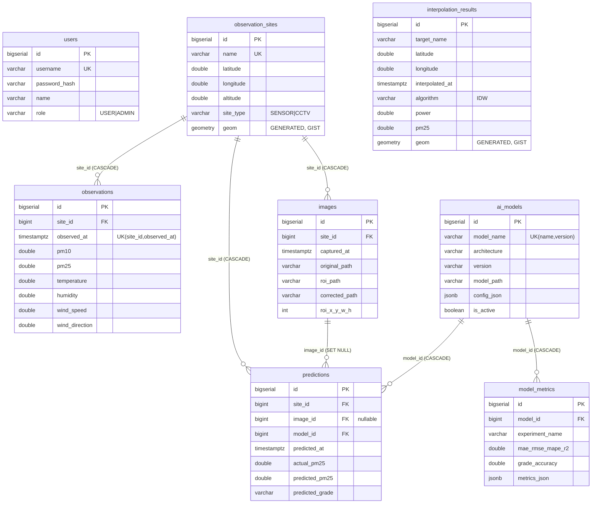

# 데이터베이스 설계서

- DBMS: 원격 PostgreSQL 16 + PostGIS 3.4
- 마이그레이션: Flyway (`backend/src/main/resources/db/migration/`)
  - V1__init_schema.sql — 전체 스키마 (PostGIS 확장 활성화 포함)
  - V2__seed_sample_data.sql — 샘플 관측소 7곳 + 최근 7일 시간당 합성 관측값
- 초기 설정 절차: `database/setup/README.md`

## ERD

## 설계 포인트

| 항목 | 내용 |
|---|---|
| 공간 컬럼 | `geom GEOMETRY(Point,4326) GENERATED ALWAYS AS (ST_SetSRID(ST_MakePoint(longitude,latitude),4326)) STORED` — 앱은 좌표만 저장 |
| 공간 인덱스 | observation_sites.geom, interpolation_results.geom에 GIST |
| 시간 인덱스 | observations(observed_at), (site_id, observed_at DESC), predictions(site_id, predicted_at DESC), interpolation_results(interpolated_at) |
| 유일성 | users.username, observation_sites.name, observations(site_id, observed_at), ai_models(model_name, version) |
| CHECK 제약 | 좌표 범위, pm 값 ≥0, 습도 0~100, 풍향 0~360 미만, role 화이트리스트 |
| 시간 타입 | 전부 TIMESTAMPTZ (UTC 저장, 표시 시 로컬 변환) |
| 대표 쿼리 | 관측소별 최신값: `DISTINCT ON (site_id) ... ORDER BY site_id, observed_at DESC` |

## 엔티티 매핑 현황 (JPA)

| 테이블 | 엔티티 | 비고 |
|---|---|---|
| users | auth.User | |
| observation_sites | site.ObservationSite | geom 미매핑(DB 생성), WKT는 네이티브 조회 |
| observations | observation.Observation | LAZY site 연관 |
| ai_models | prediction.AiModel | config_json 미매핑(현재 미사용) |
| predictions | prediction.Prediction | image_id는 단순 컬럼(이미지 관리 도입 전) |
| interpolation_results | interpolation.InterpolationResult | geom 미매핑 |
| images / model_metrics | (미매핑) | 후속 단계에서 사용 시 매핑 |
