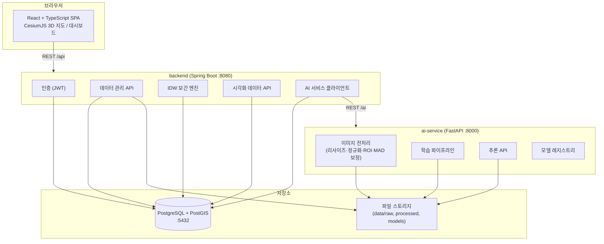
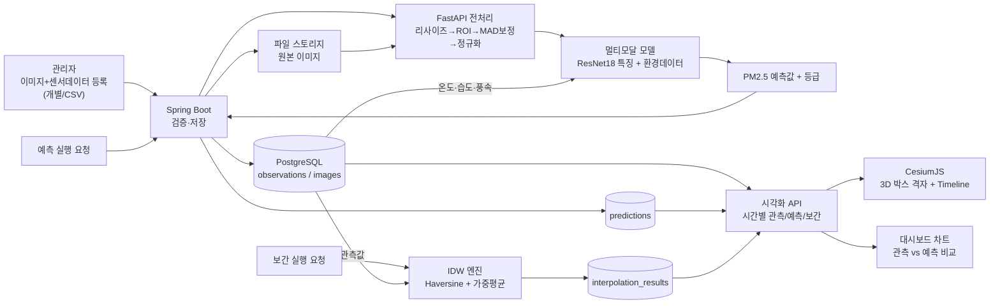

# AirVision 3D 구현 계획서 (초안)

> AI 영상인식 기반 미세먼지 예측 및 3차원 시각화 시스템
> 작성일: 2026-07-17 | 상태: DRAFT (승인 대기)

---

## 1. 프로젝트 목표

대기 이미지와 환경 센서 데이터(온도, 습도, 풍속)를 입력받아 PM2.5 농도를 예측하고,
**관측값 · AI 예측값 · IDW 보간값**을 CesiumJS 기반 3차원 웹 지도에서
시간 변화와 함께 비교·시각화하는 교육용 통합 시스템(MVP)을 한 학기 내에 완성한다.

원 과제("AI 영상인식 기반 3차원 미세먼지정보 통합시스템 시작품 제작")의 핵심 아이디어를
대학생 캡스톤 수준으로 축소·재구성하며, **재현 가능성**과 **실행 가능성**을 최우선으로 한다.

## 2. MVP 범위 (필수)

| 영역 | 포함 기능 |
|---|---|
| 데이터 관리 | 이미지 업로드, 메타데이터(시각·좌표·환경값·PM2.5 관측값) 등록, CSV 일괄 업로드, CRUD, 샘플 데이터 자동 생성기 |
| 이미지 전처리 | 리사이즈, 정규화, 설정 파일 기반 ROI 추출, MAD 기반 이상치 확인·보정, 원본/보정 비교 |
| AI 모델 | ResNet18 + 환경데이터 결합 멀티모달 회귀(PM2.5 1개 출력), 등급 계산(설정 파일 기준), 학습/평가/저장/추론 API, MAE·RMSE·MAPE·R²·등급 정확도·혼동행렬 |
| 공간 보간 | Haversine 거리, 일반 IDW(가중치 지수 p 설정 가능, 거리 0 처리), 단위 테스트, 결과 DB 저장 |
| 백엔드 | Spring Boot(인증, 데이터 관리, AI 서버 호출, IDW, 시각화 데이터 API) + FastAPI(학습·추론·전처리·헬스체크), 공통 응답 형식 |
| DB | PostgreSQL + PostGIS, 8개 테이블, Flyway 마이그레이션 |
| 프론트엔드 | React+TS+Vite+Tailwind+Zustand, 로그인/대시보드/3D지도/데이터목록/등록/예측실행/보간실행/성능비교/관리자 9개 화면 |
| 3D 시각화 | 관측소·촬영지·보간지점 표시, 관측/예측/보간 레이어 구분, 반투명 3D 박스(관측소당 3x3x2 격자), 등급별 색상(설정 관리), 클릭 팝업, 레이어 토글, 카메라 이동 |
| 시계열 | Cesium Clock/Timeline + SampledProperty 기반 시간별 색상·라벨 변경, 재생/일시정지/배속 |
| 비교 | 한 화면(지도 1 + 비교 차트)에서 관측 vs 예측 vs 보간 비교 |
| 인프라 | 로컬 프로세스 실행 + 원격 PostgreSQL, .env.example, README 단독 실행 가능 |

## 3. 제외 또는 후순위(선택) 범위

| 기능 | 분류 | 사유 |
|---|---|---|
| Modified IDW | 선택 (Phase 3 완료 후) | 일반 IDW 정확 구현·검증이 선행조건. 별도 모듈로 격리 |
| 웹 화면 드래그 ROI 선택 | 선택 | 설정 파일 방식으로 MVP 충족. UI 복잡도 높음 |
| EfficientNet-B0 비교 실험 | 선택 | ResNet18 파이프라인 완성 후 아키텍처 교체만으로 가능하도록 모델 팩토리 설계 |
| CZML 생성/로딩 | 선택 | SampledProperty 방식이 안정화된 뒤 추가 |
| 좌우 듀얼맵 | 선택 | 단일 지도+차트로 비교 요구 충족 |
| 화면 캡처 | 선택 | `viewer.canvas.toDataURL` 소규모 기능이지만 후순위 |
| 7x7x3 격자 확장 | 선택 | 3x3x2 성능 검증 후 설정값 변경으로 확장 |
| 태양고도 입력 | 선택 | 스키마에 nullable 컬럼만 예약 |
| 사용자 그룹 관리, 이메일 인증, 소셜 로그인 | 제외 | 역할 2개(USER/ADMIN)로 고정 |
| 실시간 CCTV 스트리밍 연동 | 제외 | 정적 이미지 업로드로 대체 |
| Docker, Kubernetes, CI/CD 파이프라인 | 제외 | 로컬 실행 + 원격 DB로 대체(2026-07-17 사용자 결정) |
| PM10 예측 | 제외 | 관측값 저장만, 예측 대상은 PM2.5 단일 |

## 4. 기술 스택

| 계층 | 기술 | 버전 기준 |
|---|---|---|
| 프론트엔드 | React 19, TypeScript 6, Vite 8, Tailwind CSS 4, Zustand 5, CesiumJS, Recharts, Axios | Phase 1에서 확정 |
| 백엔드 | Spring Boot 4.1, Java 21, Gradle 9, Spring Security(JWT), Spring Data JPA, Flyway, springdoc-openapi | Phase 1에서 확정 |
| AI 서비스 | Python 3.11, FastAPI 0.115, PyTorch 2.x(Phase 4~), torchvision, OpenCV, NumPy, Pandas, scikit-learn, Pydantic v2 | CPU 기준 실행 보장 |

> 버전 변경 이력: 계획 초안의 Spring Boot 3.x는 start.spring.io가 4.0 미만 생성을 종료하여 4.1로 확정(2026-07-17).
> Tailwind는 v4(@tailwindcss/vite 플러그인 방식)로 확정 — v3 대비 설정 파일이 불필요해 학생 온보딩에 유리.
| DB | 원격 PostgreSQL 16 + PostGIS 3.4 (사용자 직접 설치·운영) | |
| 인프라 | 로컬 프로세스 실행 + 원격 DB, .env 환경변수 | Windows/Ubuntu 겸용 |

> 인프라 변경 이력(2026-07-17): Docker Compose 사용 계획을 폐기하고 원격 PostgreSQL 직접 연결로 확정(사용자 결정).
> DB 접속 정보는 루트 `.env`에 입력하며 백엔드가 기동 시 자동 로드한다. 초기 설정 절차는 `database/setup/README.md` 참고.

## 5. 시스템 구성도

## 6. 데이터 흐름도

## 7. 개발 단계와 산출물

| Phase | 내용 | 주요 산출물 | 완료 조건 |
|---|---|---|---|
| 0 | 저장소 분석·계획 | implementation-plan.md, progress.md | 계획 승인 |
| 1 | 기반 구축 | 모노레포, 3개 서비스 스캐폴드, .env.example, 헬스체크 | 3개 서비스 로컬 기동, 헬스체크/기본화면 확인 |
| 2 | DB·샘플데이터 | Flyway V1~, 엔티티/Repository, CRUD API, 샘플 생성 스크립트, Swagger | 관측소·관측값 CRUD 테스트 통과, PostGIS 좌표 저장·조회 |
| 3 | IDW 보간 | Haversine·IDW 구현(Java), Python 기준 구현, 단위 테스트, 보간 API | 경계조건(거리0, 단일 관측소) 처리, Python 기준값과 허용오차 내 일치 |
| 4 | AI 데이터 파이프라인 | 전처리 모듈, ROI, MAD 보정, Dataset/DataLoader, 날짜 단위 분할, 샘플 이미지 생성기 | 샘플 데이터로 DataLoader 실행, 누수 방지 검증 |
| 5 | AI 학습·추론 | 멀티모달 모델, 학습/평가 스크립트, 모델 저장, 추론 API, 지표 저장 | CPU에서 학습 명령 실행, 추론 API 응답, 지표 5종 출력 |
| 6 | 웹 대시보드 | 로그인, 대시보드, 목록, 업로드, 예측/보간 실행, 비교 차트 | 브라우저에서 등록→예측→보간→차트 확인 전체 흐름 동작 |
| 7 | Cesium 지도 | Viewer, 아이콘, 3D 박스 격자, 색상 매핑, 클릭 팝업, 레이어 토글 | 3종 레이어 구분 표시, 농도별 색상, 클릭 상세정보 |
| 8 | 시계열 | 시간범위 API, Clock/Timeline, SampledProperty, 재생 제어 | 시간 재생에 따른 격자 변화, 데이터 없는 시간 처리 |
| 9 | 통합·배포 | 통합 테스트, 통합 실행 스크립트, README, 시연 시나리오, 보고서 목차 | README 절차만으로 전체 시연 가능 |

## 8. 15주 일정 (Phase 매핑)

| 주차 | 내용 | Phase |
|---|---|---|
| 1 | 요구사항 분석, 계획 승인, 개발환경 통일 | 0 |
| 2 | 모노레포·서비스 스캐폴드·원격 DB 연결 설정·헬스체크 | 1 |
| 3 | Flyway 스키마, 엔티티, 샘플 데이터 생성기 | 2 |
| 4 | CRUD API, CSV 업로드, Swagger, 인증(JWT) | 2 |
| 5 | Haversine·IDW 구현, 단위 테스트, Python 교차검증 | 3 |
| 6 | 이미지 전처리(ROI·MAD), Dataset, 데이터 분할 | 4 |
| 7 | 멀티모달 모델, 학습 스크립트, 1 epoch smoke test | 5 |
| 8 | **중간점검**: 평가지표, 추론 API, Spring↔FastAPI 연동 | 5 |
| 9 | 로그인·대시보드·데이터 목록/등록 화면 | 6 |
| 10 | 예측/보간 실행 화면, 비교 차트 | 6 |
| 11 | Cesium Viewer, 아이콘, 3D 박스 격자, 색상 | 7 |
| 12 | 클릭 팝업, 레이어 토글, 카메라 이동 | 7 |
| 13 | 시계열(Clock/Timeline/SampledProperty), 재생 제어 | 8 |
| 14 | 통합 테스트, 버그 수정, (여유 시 선택기능: Modified IDW 등) | 9 |
| 15 | 문서·시연 시나리오·발표 준비, **최종 시연** | 9 |

버퍼: 14주차는 의도적으로 통합·수습 주간. 선택 기능은 13주차까지 필수가 VERIFIED일 때만 착수.

## 9. 팀원 역할 분담 (4명 기준)

| 역할 | 담당 영역 | 주요 산출물 |
|---|---|---|
| A. 백엔드 리드 | Spring Boot, DB 스키마, Flyway, 인증, IDW(Java), CSV | CRUD/보간 API, DB 설계서 |
| B. AI 리드 | FastAPI, 전처리, 멀티모달 모델, 학습/평가, 추론 API | AI 모델 설계서, 성능 평가 결과 |
| C. 프론트엔드 리드 | React 화면 9종, 상태관리, 차트, API 연동 | 화면설계서, 대시보드 |
| D. 시각화·인프라 리드 | CesiumJS 3D/시계열, 원격 DB 운영, 통합 테스트, 문서 총괄 | 3D 지도, 배포 매뉴얼, 테스트 결과서 |

공통: 전원이 자기 영역 테스트 작성. 주 1회 통합 회의에서 API 계약(api-spec.md) 변경 합의.
페어 권장: 5주차 IDW(A+B 교차검증), 8주차 연동(A+B), 11~13주차 Cesium 데이터 API(C+D).

## 10. 주요 위험요소와 대응

| # | 위험 | 영향 | 대응 |
|---|---|---|---|
| 1 | **실제 라벨링 데이터(대기 이미지+PM2.5 쌍) 확보 불가** | AI 학습 무의미화 | 샘플 데이터 생성기(합성 안개 이미지+상관 환경값)로 파이프라인 검증을 1차 목표로. 에어코리아 공공데이터+직접 촬영을 병행 수집(3주차부터). 보고서에는 "파이프라인 검증" vs "실데이터 성능" 구분 명시 |
| 2 | GPU 부재로 학습 지연 | Phase 5 지연 | 224px·소규모 샘플로 CPU 학습 보장, 필요 시 Colab에서 학습 후 모델 파일만 반입(모델 저장 포맷 표준화) |
| 3 | Spring↔FastAPI 연동 장애 | 시연 실패 | 8주차 연동 리허설, FastAPI 다운 시 백엔드가 명확한 오류 응답, mock 모델 제공 |
| 4 | Cesium 학습 곡선·성능 | Phase 7~8 지연 | 관측소당 3x3x2 격자로 시작(총 엔티티 수 제한), ion 토큰 없이도 동작하는 기본 imagery 대안 확보, 11주차 전 D팀원 사전 학습 |
| 5 | 시계열 SampledProperty 성능 저하 | 재생 끊김 | 시간 해상도 1시간 단위 제한, 조회 기간 제한(기본 24~72시간), 격자 수 상한 설정값 관리 |
| 6 | 팀원 기술 격차(Java21/PyTorch/Cesium 동시 사용) | 전반 지연 | 역할별 1인 리드 + 페어 배치, 1주차 온보딩 문서, CLAUDE.md에 실행법 명문화 |
| 7 | 데이터 누수(연속 촬영 이미지의 무작위 분할) | 성능 과대평가 | 날짜/촬영 세션 단위 GroupSplit 기본값, 분할 검증 테스트 필수 |
| 8 | 범위 팽창(선택 기능 조기 착수) | 필수 미완 | progress.md의 VERIFIED 게이트: 필수 전부 VERIFIED 전 선택 기능 착수 금지 |
| 9 | Windows/Ubuntu 경로·인코딩 차이 | 실행 불가 | 경로는 설정·상대경로만 사용, UTF-8 강제, 양 OS에서 README 절차 실행 검증(9주차, 15주차) |

## 11. 검증 방법

- **백엔드**: Service 단위 테스트, Controller 통합 테스트(Testcontainers 또는 로컬 PostGIS), IDW 경계조건 테스트, 인증·잘못된 입력 테스트
- **IDW**: Java 구현 결과를 Python(NumPy) 기준 구현과 허용오차(1e-6) 비교, 결과 문서화
- **AI**: Dataset/ROI/forward 단위 테스트, 1 epoch smoke test, 추론 API 계약 테스트, 지표 계산 테스트(알려진 입력→기대 출력)
- **프론트엔드**: 주요 컴포넌트 렌더링(Vitest+RTL), API 오류 처리, 폼 유효성, 레이어 상태 테스트
- **통합**: 원격 DB 연결 상태에서 3개 서비스 기동 후 시연 시나리오(등록→예측→보간→3D 확인→시계열 재생) 수동 체크리스트
- **진행 관리**: docs/progress.md에 단계별 NOT_STARTED / IN_PROGRESS / BLOCKED / COMPLETED / VERIFIED 상태 기록. 실행·테스트 성공까지 확인해야 VERIFIED

## 12. 완료 조건 (프로젝트 전체)

1. README 절차대로 backend·ai-service·frontend 기동(원격 DB 연결)
2. README만 보고 제3자가 샘플 데이터로 전체 흐름 실행 가능
3. 시연 시나리오: 데이터 등록 → AI 예측 → IDW 보간 → 3D 지도에서 3종 레이어 비교 → 시계열 재생까지 무중단 시연
4. 회귀 지표(MAE·RMSE·MAPE·R²)와 등급 분류 지표(Accuracy·혼동행렬)가 구분되어 산출·저장·화면 표시
5. IDW가 Python 기준 구현과 일치함을 테스트로 증명
6. 캡스톤 산출물 14종(소스, 설계서, 매뉴얼, 보고서 목차 등) 준비 완료

## 13. 명시적 가정 (질문 없이 결정한 사항)

| # | 가정 | 근거 |
|---|---|---|
| 1 | 인증은 JWT 기반 stateless, 역할은 USER/ADMIN 2개 | 스펙의 "복잡한 사용자 그룹 관리 제외" |
| 2 | 이미지 저장은 DB가 아닌 로컬 파일시스템(경로만 DB 저장) | images 테이블에 *_path 컬럼 존재 |
| 3 | 샘플 데이터: 관측소 5~10개(대한민국 좌표), 관측값은 시간당 1건 × 7일, 합성 이미지(안개 강도를 PM2.5와 상관시켜 생성) | "외부 API 없어도 실행 가능" 원칙 |
| 4 | 시계열 해상도는 1시간, 기본 조회 기간 24시간 | Cesium 성능 위험 완화 |
| 5 | Spring→FastAPI 단방향 호출(FastAPI는 Spring을 호출하지 않음) | 결합도 최소화 |
| 6 | 미세먼지 등급 경계·색상은 backend/ai-service/frontend가 각자 설정 파일로 관리하되 값은 동일하게 유지(단일 소스: docs/api-spec.md에 명시) | 스펙의 "하드코딩 금지" |
| 7 | 개발 언어: 코드 식별자는 영어, 주석·문서는 한국어 | 스펙 개발원칙 11 |
| 8 | Cesium imagery는 ion 무료 토큰(팀 계정) 또는 OSM 타일 폴백 | 토큰 미확보 시에도 동작 보장 |
